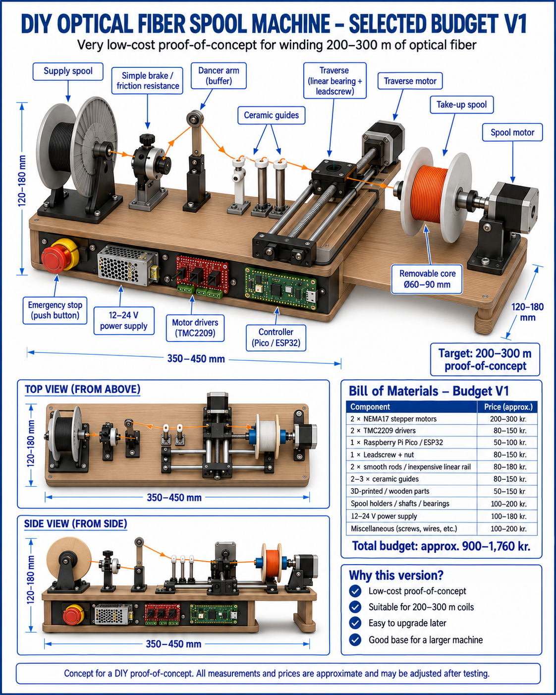
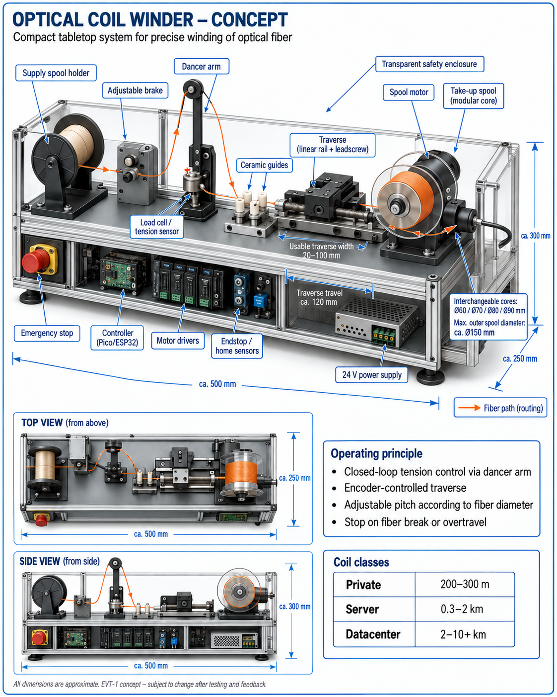
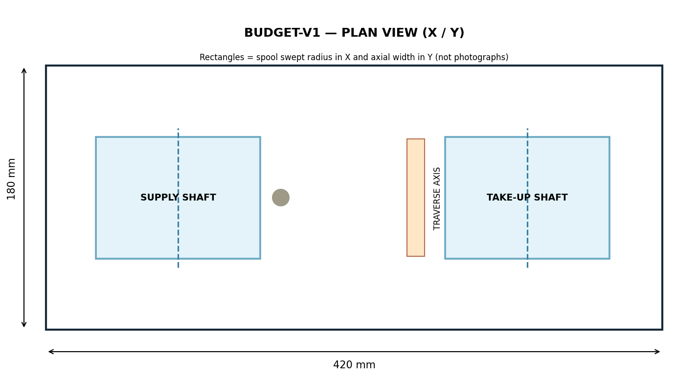
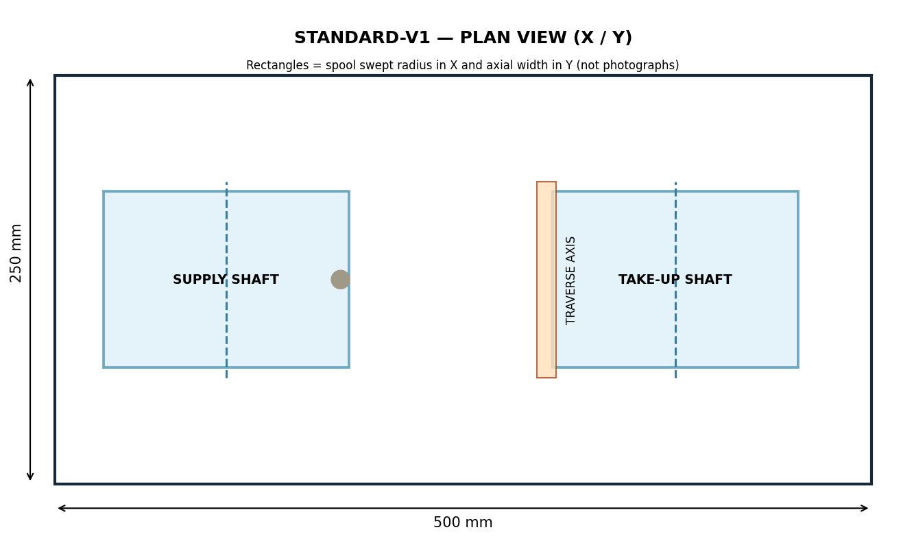

# Optical Fiber Coil Winder

**Budget V1 • 200–300 m design objective** &nbsp;|&nbsp; **Standard V1 • up to 10 km thin-coated-fiber design objective**

> **Engineering prototype / v1.0.0-RC1.1 — SOFTWARE-TESTED, HARDWARE NOT VERIFIED.**
> The ZIP includes real parametric CAD source and exported STEP/STL, host calculation and simulation software, ESP32 firmware prototypes, assembly diagrams, electrical architecture and test data. **Do not energize or fabricate the machine on this evidence alone.**

**Documentation:** English (this file) · [Dansk](README_DA.md) · [Release evidence](docs/VERIFICATION_REPORT.md) · [Safety](docs/SAFETY.md) · [License review](LICENSE_REVIEW.md)

### Original design concepts (unchanged owner-supplied images)





These images are *conceptual illustrations*, not photographs or evidence of as-built devices. Their original bytes and SHA-256 are documented in the [source image manifest](assets/original-concept-images/SOURCE_MANIFEST.json).

### Nominal engineering views (generated from CAD)





The engineering drawings are **derived nominal CAD views**, not photographs. See [original image provenance](assets/original-concept-images/README.md).

## The two versions

| Metric | Budget V1 | Standard/Premium V1 |
|---|---|---|
| Design target | 200–300 m | Up to 10,000 m |
| Nominal base / envelope | 420 × 180 × 165 mm limit | 500 × 250 × 300 mm limit |
| Example winding medium | 0.9 mm buffered fiber, **unqualified example** | 0.25 mm coated fiber, **unqualified example** |
| Core / max flange outer diameter | 60 / 112 mm | 90 / 150 mm |
| Winding width | 75 mm | 100 mm |
| Mechanism | Passive dancer + adjustable brake | Load cell, dancer, quadrature encoder (prototype feedback model) |
| Host geometric calculation | ~390 m with 0.9 mm fiber | ~11,105 m with 0.25 mm fiber |
| Feasibility classification | Geometry fits 300 m; physical test HOLD | Geometry fits 10 km; physical test HOLD |
| Unquoted component allowance | DKK 2,242 | DKK 3,327 |
| Motor activation as delivered | **Build-locked OFF** | **Build-locked OFF** |

**Critical limitation:** the 10 km objective is *not* demonstrated for 900 µm buffered fiber, 2 mm jacketed cable, or arbitrary optical media. A modelled 10 km winding assumes a specified 250 µm coated product and a 1.25× winding pitch/radial spacing factor. Procurement and handling constraints may invalidate that assumption. This is a spatial model only, **not a verified machine capacity or fiber performance claim**.

## Try it without hardware

Python 3.11+ is sufficient for the calculator:

```bash
python common/fiber-calculations/fiber.py --core-mm 90 --outer-mm 150 --width-mm 100 --fiber-mm 0.25 --target-m 10000 --pitch-factor 1.25 --radial-factor 1.25 --side-margin-mm 2
python common/fiber-calculations/fiber.py --core-mm 60 --outer-mm 112 --width-mm 75 --fiber-mm 0.9 --target-m 300 --pitch-factor 1.25 --radial-factor 1.25 --side-margin-mm 2
python common/simulation/demo.py
```

To run the software evidence tests (the host dependencies are pinned for repeatability; CAD tests also require ezdxf):

```bash
python -m pip install -r requirements-host-tests.txt
python tools/run_tests.py
```

Regenerate CAD STEP/STL/DXF and nominal drawings (CadQuery, matplotlib, ezdxf required):

```bash
python -m pip install cadquery matplotlib ezdxf
python tools/build_cad.py
```

ESP32 prototype firmware is under each machine's [`firmware/`](budget-v1/firmware/platformio.ini) and [`firmware/`](standard-v1/firmware/platformio.ini) folder (PlatformIO; Arduino framework). The real-motion compilation flag deliberately defaults to `ENABLE_REAL_MOTION 0`. **No embedded build or board flash has been verified in this release.** The purpose is to review source and exercise a host-side simulation, not to operate a powered machine.

## Explore the engineering package

- [Requirements and concept traceability](docs/REQUIREMENTS_MATRIX.md)
- [Architecture](docs/ARCHITECTURE.md) and [Nominal specifications](docs/SPECIFICATIONS.md)
- [Fiber geometry and limits](docs/FIBER_ENGINEERING.md) and [machine-readable 36-case scenario table](results/capacity_scenarios.csv)
- [Budget BOM](budget-v1/bom/bom.csv) and [Standard BOM](standard-v1/bom/bom.csv); see [estimate caveats](docs/LIMITATIONS.md)
- [Budget build sequence](docs/BUILD_GUIDE_BUDGET.md), [Standard build sequence](docs/BUILD_GUIDE_STANDARD.md), [calibration](docs/CALIBRATION.md)
- [Risk evaluation](docs/SAFETY.md), [physical test plan](docs/TEST_PLAN.md), [host verification](docs/VERIFICATION_REPORT.md)
- [CAD manifest](results/cad_manifest.json), [firmware controls](docs/FIRMWARE.md), [roadmap](docs/ROADMAP.md)
- [Static project information site](website/index.html), [release notes](RELEASE_NOTES.md)

## Status and publication

This project is independent of any optical computing or other external project: no other repository was edited. Build parameters and component references are development assumptions and are labelled **FIT VERIFICATION REQUIRED** until measurements and prototype tests exist. Both supplied concept illustrations are embedded unchanged and recorded in the source manifest; this does not establish physical fit or production readiness.

The proposed noncommercial research/evaluation terms are in [LICENSE_REVIEW.md](LICENSE_REVIEW.md), **not approved**. Until approved, the root [LICENSE](LICENSE) reserves all rights. Consequently the package must **not** be described as OSI open source or as an automatically licensed hardware kit.

Copyright © 2026 Janus Rokkjær.
