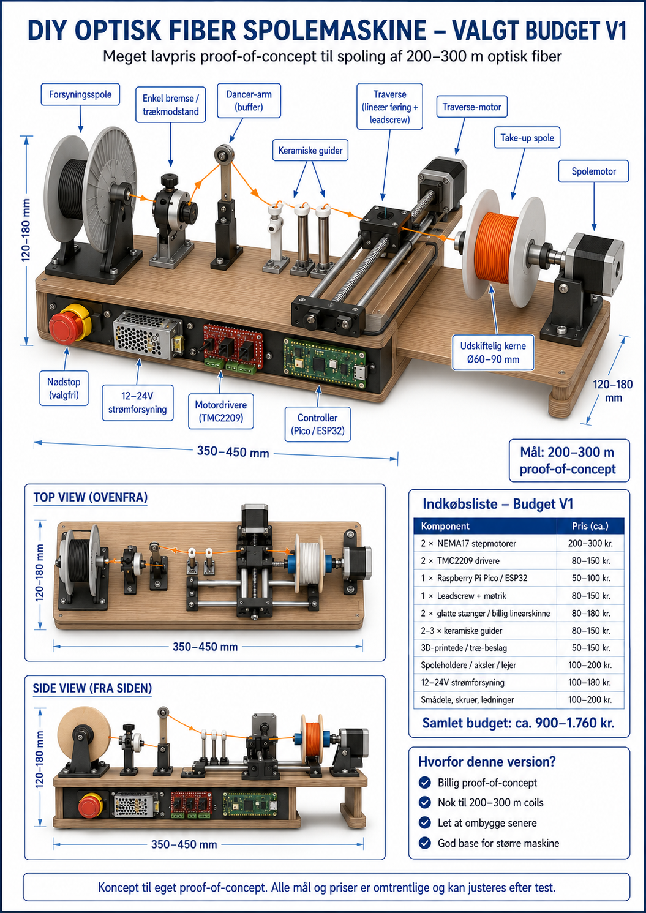
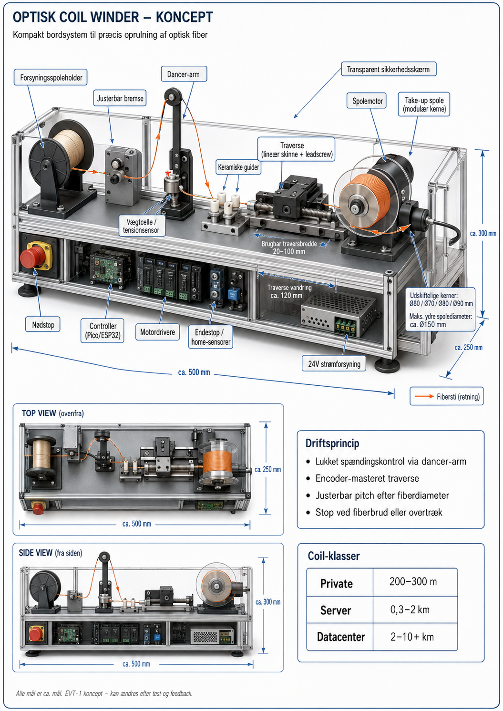

# Optisk fiberspolemaskine — Budget og Standard

**RC1.1: teknisk prototypegrundlag, ikke fysisk godkendt hardware.** Indeholder reelle 3D-modeldele i STEP/STL, parameterstyret CadQuery-kilde, 2D-måltegninger, en offline fiberberegner, hostsimulator, firmwarekilde til ESP32 og kontrollerbare testdata. Alle test-PASS gælder alene software/geometri.

### Originale konceptillustrationer – uændrede filer





Billederne er konceptvisualiseringer, **ikke fotografier af færdige maskiner**. Originale filbytes og SHA-256 er dokumenteret i [billedmanifestet](assets/original-concept-images/SOURCE_MANIFEST.json).

### CAD-genererede oversigtstegninger


## Projektmål

**Budget V1:** 420 × 180 mm bundplade, op til 165 mm konceptuel højde, Ø60 mm spolekerne, Ø112 mm flange, 75 mm bredde. Med en **eksempelvis** 0,9 mm buffered fiber og 1,25× lagafstand er den beregnede geometriske kapacitet ca. **390 m**, så 200–300 m ligger inden for geometrien. Denne kapacitet er **ikke en målt kapacitet** og forudsætter en kompatibel fibertype.

**Standard/Premium V1:** 500 × 250 × 300 mm ydre konceptmål, Ø90 mm spolekerne, Ø150 mm flange og 100 mm spolebredde. Beregnet teoretisk kapacitet ca. **11.105 m med 0,25 mm coated fiber**, hvilket er en mulig geometrisk vej mod 10 km. Den samme spole rummer kun ca. **866 m med 0,9 mm buffered fiber** under identiske antagelser. Det faktiske fiberprodukt skal godkendes med hensyn til bøjningsradius, trækkraft, coating og optiske tab.

## Hvad er fremstillet?

- 26 parametriske parttyper eksporteret som både STEP og STL (13 til hver maskinvariant), samt samlings-STEP og DXF-boretegninger.
- To komplette materialelister i CSV. Foreløbige, **ikke tilbudsbaserede** samlede delebudgetter: Budget **2.242 kr.** og Standard **3.327 kr.**, eksklusive moms, fragt, værktøj og fiber. Budgetmålet 900–1.760 kr. er altså **ikke opnået** uden yderligere afklaring.
- Reelt Python-beregningsmodul, en modelsimulator og ESP32-firmwareprototyper med fysisk motordrift låst fra som standard.
- Særskilt rapport med PASS/FAIL-tests og opgaver markeret BLOCKED/HOLD.

## Kør uden maskine

```bash
python common/fiber-calculations/fiber.py --core-mm 90 --outer-mm 150 --width-mm 100 --fiber-mm 0.25 --target-m 10000 --pitch-factor 1.25 --radial-factor 1.25 --side-margin-mm 2
python common/simulation/demo.py
python -m pip install -r requirements-host-tests.txt
python tools/run_tests.py
```

Alle CAD-dele er nominel geometri. Faktiske motorer, lejer, aksler, koblinger, remtræk, nødstop, afskærmning og elektroniske komponenter skal vælges og fysisk verificeres. De to originalillustrationer er nu indsat uændret med registrerede SHA-256-værdier; se [kildebilleder og provenance](assets/original-concept-images/README.md).

Læs den [engelske hoved-README](README.md), [fiberberegninger](docs/FIBER_ENGINEERING.md), [sikkerhed](docs/SAFETY.md), [måleplan](docs/TEST_PLAN.md), [verifikationsrapport](docs/VERIFICATION_REPORT.md), [Budget-byggevejledning](docs/BUILD_GUIDE_BUDGET.md) og [Standard-byggevejledning](docs/BUILD_GUIDE_STANDARD.md).

**Ingen fysisk test, nødstopgodkendelse, firmwarekompilering eller optisk måling er dokumenteret.** Licensvilkår er kun et [udkast til ejerens godkendelse](LICENSE_REVIEW.md); den foreliggende [LICENSE](LICENSE) forbeholder rettigheder. Projektet er ikke automatisk frigivet som OSI-open source.

Copyright © 2026 Janus Rokkjær.
